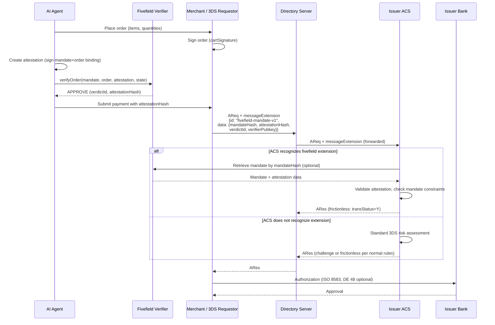
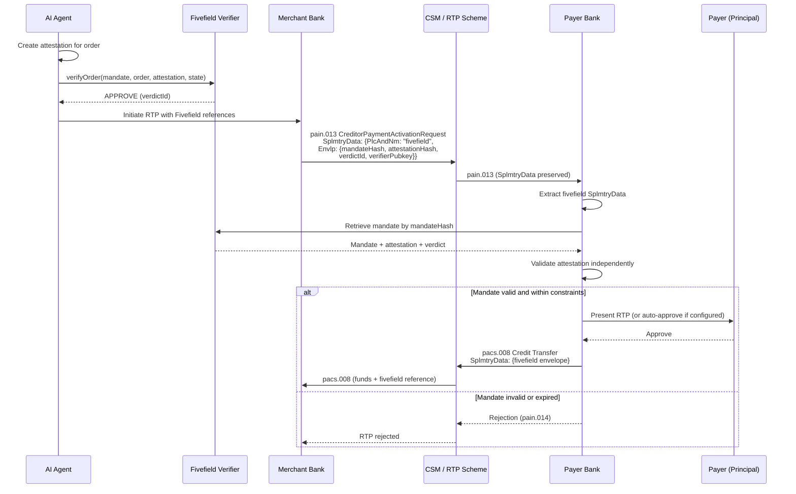
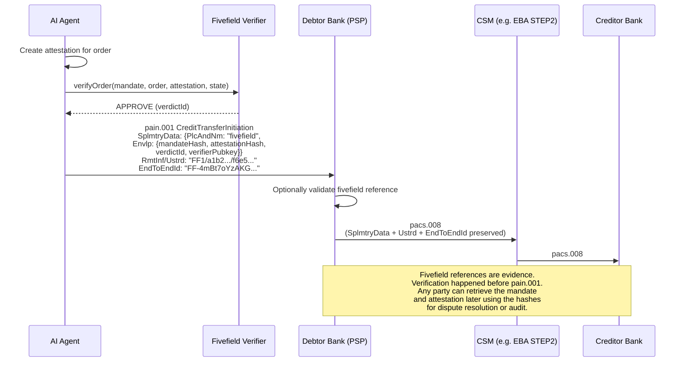

# Fivefield Protocol: Transporting Mandate Data in ISO 20022 and ISO 8583 Messages

> Version 0.1 -- 2026-11-04 -- PROPOSAL
>
> Target audience: payment system architects at banks, PSPs, and card schemes.
> This document does not define a new message format. It describes how Fivefield
> Protocol attestation references travel inside **existing** payment message
> fields, using only structures that are already defined in the relevant
> standards.

---

## 1. Design Principle: Only Hashes Travel

A Fivefield mandate contains the principal's public key, the agent's
identity, spending constraints, liability policy, and validity window
(see `sdk/src/types.ts`). An attestation binds a specific order to that
mandate with the agent's signature. A verdict records the verifier's
APPROVE/REJECT decision.

**None of these objects travel in cleartext inside the payment message.**

What travels is a minimal reference envelope:

| Field            | Size     | Description                                              |
|------------------|----------|----------------------------------------------------------|
| `mandateHash`    | 32 bytes | SHA-256 of the canonicalized mandate (hex = 64 chars)    |
| `attestationHash`| 32 bytes | SHA-256 of the canonicalized attestation (hex = 64 chars)|
| `verdictId`      | variable | On-chain verdict account address (optional)              |
| `verifierPubkey` | 32 bytes | Ed25519/ES256 public key of verifier (optional)          |
| `version`        | 1 byte   | Envelope version, currently `1`                          |

**Reasons for hash-only transport:**

1. **Privacy.** The mandate discloses the principal's spending limits, allowed
   merchants, and SKU constraints. Intermediary banks and clearing systems
   have no need for this data and should not see it.
2. **Message length.** ISO 20022 `RemittanceInformation/Unstructured` is
   capped at 140 characters. ISO 8583 private data elements have scheme-
   specific length limits. A full mandate (typically 400-800 bytes JSON)
   does not fit.
3. **Verification happens before the message.** The verifier runs
   `verifyOrder()` before the payment is initiated. The payment message is
   evidence that verification occurred, not the verification input.
4. **The mandate lives at the verifier and the principal.** Any party that
   needs to inspect the mandate (e.g., during a dispute) retrieves it from
   the verifier or the principal's agent platform using the hash as a
   lookup key.

### 1.1 Reference Envelope Schema

```json
{
  "$schema": "https://json-schema.org/draft/2020-12/schema",
  "$id": "https://fivefield.io/schemas/fivefield-mandate-v1.json",
  "title": "Fivefield Mandate Reference Envelope",
  "type": "object",
  "required": ["version", "mandateHash", "attestationHash"],
  "properties": {
    "version": {
      "type": "integer",
      "const": 1
    },
    "mandateHash": {
      "type": "string",
      "pattern": "^[0-9a-f]{64}$",
      "description": "SHA-256 of canonicalized Mandate, lowercase hex"
    },
    "attestationHash": {
      "type": "string",
      "pattern": "^[0-9a-f]{64}$",
      "description": "SHA-256 of canonicalized Attestation, lowercase hex"
    },
    "verdictId": {
      "type": "string",
      "description": "On-chain verdict account address (base58), optional"
    },
    "verifierPubkey": {
      "type": "string",
      "description": "Public key of the verifier that approved the transaction (base58), optional"
    }
  },
  "additionalProperties": false
}
```

---

## 2. ISO 20022: SEPA Credit Transfer and SEPA Instant

The relevant message types for SEPA Credit Transfer are:

- **pain.001** (CustomerCreditTransferInitiation) -- debtor to debtor bank
- **pacs.008** (FIToFICustomerCreditTransfer) -- interbank clearing
- **pain.013** (CreditorPaymentActivationRequest) -- Request to Pay (RTP)

### 2.1 Primary Path: SupplementaryData (SplmtryData)

ISO 20022 messages include a `SupplementaryData` element at the payment
instruction level. This is the recommended transport for Fivefield
references because it is designed for exactly this purpose: carrying
additional scheme-specific or bilateral data without modifying the core
message structure.

**Location in pain.001.001.09 (CustomerCreditTransferInitiation):**

```
CstmrCdtTrfInitn
  PmtInf
    CdtTrfTxInf
      SplmtryData
        PlcAndNm: "fivefield"
        Envlp: (fivefield-mandate-v1 JSON)
```

**Location in pacs.008.001.08 (FIToFICustomerCreditTransfer):**

```
FIToFICstmrCdtTrf
  CdtTrfTxInf
    SplmtryData
      PlcAndNm: "fivefield"
      Envlp: (fivefield-mandate-v1 JSON)
```

The `SplmtryData` element is defined in the ISO 20022 Message Definition
Report as follows:

- `PlcAndNm` (PlaceAndName): `xs:string`, maxLength 350. We use the fixed
  value `"fivefield"` to identify the envelope type.
- `Envlp` (Envelope): `xs:any` -- accepts any well-formed XML or, in JSON-
  based ISO 20022 implementations (per ISO 20022 JSON serialization rules),
  a JSON object.

**Example SplmtryData content (XML serialization):**

```xml
<SplmtryData>
  <PlcAndNm>fivefield</PlcAndNm>
  <Envlp>
    <FvfldMndtRef xmlns="urn:fivefield:mandate:1">
      <Vrsn>1</Vrsn>
      <MndtHash>a1b2c3d4e5f6...64 hex chars...</MndtHash>
      <AtttnHash>f6e5d4c3b2a1...64 hex chars...</AtttnHash>
      <VrdctId>7Xk9...base58...</VrdctId>
      <VrfrPubkey>3Hm8...base58...</VrfrPubkey>
    </FvfldMndtRef>
  </Envlp>
</SplmtryData>
```

**Example SplmtryData content (JSON serialization):**

```json
{
  "PlcAndNm": "fivefield",
  "Envlp": {
    "version": 1,
    "mandateHash": "a1b2c3d4e5f6...64 hex chars...",
    "attestationHash": "f6e5d4c3b2a1...64 hex chars...",
    "verdictId": "7Xk9...base58...",
    "verifierPubkey": "3Hm8...base58..."
  }
}
```

**Status:** Proposal. `SplmtryData` is a standard element; no schema
modification is needed at the message level. Banks and CSMs (Clearing and
Settlement Mechanisms) that do not recognize `PlcAndNm = "fivefield"` will
pass the element through unchanged, which is the intended behavior per ISO
20022 rules for supplementary data.

### 2.2 Fallback: RemittanceInformation/Unstructured

If `SplmtryData` is stripped by an intermediary (some CSMs drop unknown
supplementary data), the mandate and attestation hashes can be placed in
the unstructured remittance field.

**Constraint:** `RmtInf/Ustrd` has a maximum length of **140 characters**
in SEPA (EPC guidelines, based on pain.001.001.09 and pacs.008.001.08).

**Format:** `FF1/<mandateHash hex>/<attestationHash hex, first 32 chars>`

**Length calculation:**

| Component                           | Characters |
|-------------------------------------|------------|
| Prefix `FF1/`                       | 4          |
| mandateHash (full, 64 hex chars)    | 64         |
| Separator `/`                       | 1          |
| attestationHash (first 32 hex chars)| 32         |
| **Total**                           | **101**    |

101 characters fits within the 140-character limit with 39 characters to
spare.

If both hashes are needed in full:

| Component                           | Characters |
|-------------------------------------|------------|
| Prefix `FF1/`                       | 4          |
| mandateHash (full, 64 hex chars)    | 64         |
| Separator `/`                       | 1          |
| attestationHash (full, 64 hex chars)| 64         |
| **Total**                           | **133**    |

133 characters also fits within the 140-character limit with 7 characters
to spare. **Both full hashes can be transmitted in Ustrd.**

**Recommended format with both full hashes:**

```
FF1/a1b2c3d4e5f678901234567890abcdef1234567890abcdef1234567890abcdef/f6e5d4c3b2a1789012345678abcdef901234567890abcdef1234567890abcdef
```

**What is lost compared to SplmtryData:** `verdictId`, `verifierPubkey`,
and `version` do not fit. The prefix `FF1` implies version 1. The verdict
and verifier must be looked up using the hashes as keys.

**Location in pain.001.001.09:**

```
CstmrCdtTrfInitn
  PmtInf
    CdtTrfTxInf
      RmtInf
        Ustrd: "FF1/a1b2...64.../f6e5...64..."
```

**Status:** Proposal. This is a pure convention; the `Ustrd` field accepts
freeform text.

### 2.3 EndToEndId as Correlation Key

The `EndToEndId` field (CdtTrfTxInf/PmtId/EndToEndId in pain.001, same
path in pacs.008) has a maximum length of **35 characters** and is
preserved end-to-end through the payment chain. It cannot carry a full
64-character hex hash.

**Proposal:** Encode the first 24 bytes of the attestationHash in Base58,
prefixed with `FF-`.

**Length calculation:**
- 24 bytes of SHA-256 encoded in Base58 = up to 33 characters
- Prefix `FF-` = 3 characters
- Total: up to 36 characters

This exceeds 35 by one character. Reduce to 23 bytes:
- 23 bytes in Base58 = up to 32 characters
- Prefix `FF-` = 3 characters
- Total: up to 35 characters -- fits exactly.

**Example:**

```
EndToEndId: FF-4mBt7oYzAKGhvCR1VXxDnEpS7n
```

This is a **correlation key**, not a verification input. It allows any
party in the payment chain to look up the full attestation by prefix
match. Since the first 23 bytes of SHA-256 provide 184 bits of entropy,
collision probability is negligible.

**Status:** Proposal.

### 2.4 MandateRelatedInformation: Do Not Reuse

ISO 20022 pain.008 (Direct Debit) contains `MndtRltdInf`
(MandateRelatedInformation) which carries the SEPA Direct Debit mandate
reference (Unique Mandate Reference / UMR), date of signature, and
amendment details.

**This is a different concept.** The SEPA DD mandate is an agreement
between debtor and creditor authorizing the creditor to collect funds.
It is a billing relationship. The Fivefield mandate is a constraint
envelope authorizing an AI agent to initiate payments on behalf of a
principal, with deterministic verification and liability assignment.

However, the analogy is useful for explaining Fivefield to payment
architects: both are "pre-authorization with constraints." The SEPA DD
mandate says "creditor X may debit up to the agreed amount on agreed
dates." The Fivefield mandate says "agent Y may spend up to Z in
categories C at merchants M." The key differences are that Fivefield
mandates are cryptographically signed, carry an explicit liability model,
and are verified deterministically before payment initiation rather than
checked retrospectively.

**Do not place Fivefield references in `MndtRltdInf`.** That element is
reserved for SEPA DD mandates and will be validated as such by CSMs.

### 2.5 SEPA Request-to-Pay / Wero (pain.013)

SEPA Request-to-Pay (RTP) uses pain.013 (CreditorPaymentActivationRequest)
to send a payment request from the creditor (merchant) to the debtor
(payer) via their respective banks.

**This is the strongest use case for Fivefield in ISO 20022.** In the RTP
flow, the merchant's agent has already been verified by the Fivefield
verifier. The merchant includes the mandate reference in the RTP request.
The payer's bank receives the reference *before* the payer approves the
payment, enabling pre-approval verification at the issuer side.

**Location in pain.013.001.07 (CreditorPaymentActivationRequest):**

```
CdtrPmtActvtnReq
  PmtInf
    CdtTrfTx
      SplmtryData
        PlcAndNm: "fivefield"
        Envlp: (fivefield-mandate-v1 JSON)
```

The `SplmtryData` element exists at the `CdtTrfTx` (CreditTransferTransaction)
level in pain.013.001.07, following the same pattern as pain.001.

**Flow:**

1. AI agent selects items at merchant. Merchant signs the order.
2. Agent creates attestation. Verifier runs `verifyOrder()` and approves.
3. Merchant sends pain.013 RTP request to payer's bank, including
   `SplmtryData` with the Fivefield envelope (mandateHash,
   attestationHash, verdictId, verifierPubkey).
4. Payer's bank extracts the Fivefield reference. Optionally, it verifies
   the attestation independently by retrieving the mandate from the
   verifier using the mandateHash and re-running `verifyOrder()`.
5. Payer's bank presents the payment request to the payer (or auto-
   approves if the payer has configured agent-initiated payments).
6. Payer confirms. Payment is executed via pacs.008 with the same
   Fivefield references preserved in `SplmtryData`.

**Why this is the strongest case:** The payer's bank sees the Fivefield
proof *before* any funds move. It can reject the payment if the
attestation is invalid, the mandate has expired, or the verifier's
signature is not recognized. This is issuer-side verification -- the same
trust model as EMV 3DS but for agent-initiated payments.

**Status:** Proposal. The `SplmtryData` element in pain.013.001.07 is
specified identically to pain.001 and accepts the same structure. The
verification logic at the payer's bank is new functionality.

---

## 3. ISO 8583: Card Authorization

### 3.1 DE 48 -- Additional Data, Private Use

Data Element 48 in ISO 8583:1987 and ISO 8583:2003 is designated for
private use between acquirer and issuer, or within a scheme's
specifications. Most card schemes (Visa, Mastercard, UnionPay) define
sub-elements within DE 48 using TLV (Tag-Length-Value) encoding.

**Proposal: Fivefield sub-element in DE 48**

| Property       | Value                            |
|----------------|----------------------------------|
| Tag            | Scheme-assigned (proposal: `FF`) |
| Length          | Variable, up to 165 bytes        |
| Format         | ASCII or BCD, scheme-dependent   |

**ASCII encoding (165 bytes):**

| Offset | Length | Content                              |
|--------|--------|--------------------------------------|
| 0-1    | 2      | Tag `FF`                             |
| 2-4    | 3      | Length `161` (ASCII digits)           |
| 5-6    | 2      | Version `01`                         |
| 7-70   | 64     | mandateHash (hex ASCII)              |
| 71-134 | 64     | attestationHash (hex ASCII)          |
| 135-165| 31     | verdictId prefix (Base58, padded)    |

Total: 166 bytes (tag + length + data).

**BCD encoding (87 bytes):**

| Offset | Length | Content                              |
|--------|--------|--------------------------------------|
| 0-1    | 2      | Tag `FF` (hex)                       |
| 2      | 1      | Length `84` (hex = 132 decimal)       |
| 3      | 1      | Version `01` (hex)                   |
| 4-35   | 32     | mandateHash (raw bytes)              |
| 36-67  | 32     | attestationHash (raw bytes)          |
| 68-83  | 16     | verdictId prefix (raw, optional)     |

Total: 84 bytes (tag + length + data).

**Honest assessment:** The specific tag assignment within DE 48 is the
card scheme's decision. Each scheme maintains its own sub-element
registry for DE 48. This proposal demonstrates that the data fits within
typical DE 48 size limits (Visa allows up to 999 bytes in DE 48;
Mastercard allows up to 999 bytes). The actual tag value, encoding
rules, and sub-element position would be defined by the scheme in its
implementation specification.

### 3.2 Alternative Data Elements

Other data elements that could carry Fivefield references:

- **DE 104** (Transaction Description): Free text, up to 100 characters
  in some implementations. Could carry the `FF1/...` format from Section
  2.2. Length varies by scheme. *To be verified* against specific scheme
  specifications.
- **DE 124-127**: Reserved for private use in most scheme specifications.
  These are available for bilateral agreements between acquirer and issuer.
  No specific proposal is made because the element definitions are
  scheme-specific and not publicly standardized.

**Status:** Proposal for all DE-based approaches. The scheme controls
field allocation.

### 3.3 EMV 3-D Secure 2.x: messageExtension in AReq

EMV 3-D Secure (3DS) versions 2.2 and 2.3 define a `messageExtension`
array in the Authentication Request (AReq) and Authentication Response
(ARes) messages. This is the realistic path for card-not-present
transactions because the issuer's Access Control Server (ACS) processes
the AReq before the cardholder is authenticated.

**EMV 3DS 2.2+ messageExtension structure:**

The `messageExtension` field is defined in the EMV 3DS Protocol and Core
Functions Specification as an array of extension objects. Each extension
contains:

| Field                  | Type    | Max Length | Description                         |
|------------------------|---------|------------|-------------------------------------|
| `name`                 | String  | 64         | Extension name                      |
| `id`                   | String  | 64         | Unique identifier for the extension |
| `criticalityIndicator` | Boolean | --         | Whether the ACS must understand it  |
| `data`                 | Object  | 8192       | Extension-specific data             |

**Fivefield extension:**

```json
{
  "name": "fivefield-mandate-v1",
  "id": "fivefield-mandate-v1",
  "criticalityIndicator": false,
  "data": {
    "version": 1,
    "mandateHash": "a1b2c3d4e5f678901234567890abcdef1234567890abcdef1234567890abcdef",
    "attestationHash": "f6e5d4c3b2a1789012345678abcdef901234567890abcdef1234567890abcdef",
    "verdictId": "7Xk9Qm...",
    "verifierPubkey": "3Hm8Bp..."
  }
}
```

**`criticalityIndicator: false`** means an ACS that does not understand
the extension will ignore it and proceed with standard 3DS authentication.
An ACS that recognizes the extension can use the Fivefield reference for
enhanced risk assessment or to auto-approve low-risk agent-initiated
transactions that have been pre-verified.

**Flow:**

1. AI agent selects items. Verifier approves the order.
2. The 3DS Requestor (merchant's 3DS integration) includes the Fivefield
   messageExtension in the AReq sent to the Directory Server.
3. The Directory Server routes the AReq (with extension) to the issuer's
   ACS.
4. The ACS extracts the Fivefield extension. If it recognizes the
   extension, it can retrieve the mandate from the verifier and validate
   the attestation. If the agent's action was pre-approved under a valid
   mandate, the ACS may issue a frictionless authentication (no cardholder
   challenge).
5. If the ACS does not recognize the extension, standard 3DS
   authentication proceeds.

**Why this works:** The `messageExtension` mechanism exists precisely for
scheme-specific or proprietary extensions. The EMV 3DS specification
explicitly states that extensions with `criticalityIndicator: false` must
be ignored by implementations that do not support them, ensuring backward
compatibility.

**Status:** Proposal. The `messageExtension` mechanism is defined in the
EMV 3DS 2.2 and 2.3 specifications. The specific extension content
(`fivefield-mandate-v1`) would need to be registered with EMVCo or used
under bilateral agreement between acquirer and issuer.

### 3.4 Mastercard Verifiable Intent

Mastercard's Verifiable Intent (VI) framework already provides a transport
layer for agent mandates in card-present and card-not-present flows. The
existing Fivefield VI adapter (`adapters/verifiable-intent/src/vi-adapter.ts`)
translates between Fivefield mandates and VI's SD-JWT credential chain.

When VI is available, the mandate travels in the VI payload structure
(L1/L2/L3 SD-JWT chain) rather than in an ISO 8583 data element. No 8583
field is needed because the VI framework handles its own transport between
issuer, merchant, and agent.

**The 3DS messageExtension approach (Section 3.3) is for schemes and
issuers that do not participate in VI.** The two approaches are
complementary, not competing.

---

## 4. Sequence Diagrams

### 4.1 Card-Not-Present with 3DS Extension (Verification at Issuer ACS)



### 4.2 SEPA Request-to-Pay (Verification at Payer Bank)



### 4.3 SEPA Credit Transfer Post-Hoc (Hash in SplmtryData as Evidence)



---

## 5. Summary Table

| Message | Field | Max Length | What Is Inside | Who Reads It | Status |
|---------|-------|-----------|----------------|-------------|--------|
| pain.001.001.09 (SCT Init) | `CdtTrfTxInf/SplmtryData` | Unbounded (schema-defined) | Full envelope JSON: mandateHash, attestationHash, verdictId, verifierPubkey, version | Debtor bank (optional), creditor bank (optional), dispute systems | Proposal |
| pain.001.001.09 (SCT Init) | `CdtTrfTxInf/RmtInf/Ustrd` | 140 chars | `FF1/<mandateHash 64hex>/<attestationHash 64hex>` = 133 chars | Any party in chain; fallback if SplmtryData stripped | Proposal |
| pain.001.001.09 (SCT Init) | `PmtId/EndToEndId` | 35 chars | `FF-` + Base58(attestationHash first 23 bytes) = up to 35 chars | Correlation key for reconciliation | Proposal |
| pacs.008.001.08 (Interbank) | `CdtTrfTxInf/SplmtryData` | Unbounded | Same as pain.001 SplmtryData | Intermediary banks, creditor bank | Proposal |
| pain.013.001.07 (RTP/Wero) | `CdtTrfTx/SplmtryData` | Unbounded | Same as pain.001 SplmtryData | Payer bank (verification before approval) | Proposal |
| ISO 8583 Authorization | DE 48 sub-element `FF` | 165 bytes ASCII / 84 bytes BCD | mandateHash + attestationHash + verdictId prefix | Issuer (authorization decision) | Proposal -- tag assignment is scheme decision |
| ISO 8583 Authorization | DE 104 | ~100 chars (scheme-dependent, *to be verified*) | `FF1/<mandateHash>/<attestationHash prefix>` | Issuer | Proposal |
| EMV 3DS 2.2+ AReq | `messageExtension[]` | 8192 bytes per extension | Full envelope JSON (same schema as SplmtryData) | Issuer ACS (pre-authentication) | Proposal -- extension registration needed |
| Mastercard VI payload | VI L2/L3 SD-JWT chain | Per VI spec | Full mandate as SD-JWT (via existing VI adapter) | Issuer, merchant | Implemented (adapter exists) |

---

## 6. Field Name Verification

The following field names and paths have been verified against the
published ISO 20022 message definition reports and EMV 3DS specifications:

| Field Path | Source | Verified |
|-----------|--------|----------|
| `CstmrCdtTrfInitn/PmtInf/CdtTrfTxInf/SplmtryData` | pain.001.001.09 MX schema | Yes -- SplmtryData is defined at CreditTransferTransactionInformation level |
| `SplmtryData/PlcAndNm` | ISO 20022 SupplementaryData1 type | Yes -- xs:string, maxLength 350 |
| `SplmtryData/Envlp` | ISO 20022 SupplementaryDataEnvelope1 type | Yes -- xs:any |
| `CdtTrfTxInf/RmtInf/Ustrd` | pain.001.001.09 | Yes -- Max140Text |
| `PmtId/EndToEndId` | pain.001.001.09 | Yes -- Max35Text |
| `FIToFICstmrCdtTrf/CdtTrfTxInf/SplmtryData` | pacs.008.001.08 | Yes -- same SplmtryData type |
| `CdtrPmtActvtnReq/PmtInf/CdtTrfTx/SplmtryData` | pain.013.001.07 | Yes -- SplmtryData at CreditTransferTransaction level |
| `MndtRltdInf` | pain.008 (DirectDebitTransactionInformation) | Yes -- exists but is for SEPA DD mandates only |
| `messageExtension` (AReq) | EMV 3DS 2.2 Protocol Spec, Section 3.2.1 | Yes -- array of MessageExtension objects |
| `messageExtension.name` | EMV 3DS 2.2 | Yes -- String, max 64 |
| `messageExtension.id` | EMV 3DS 2.2 | Yes -- String, max 64 |
| `messageExtension.criticalityIndicator` | EMV 3DS 2.2 | Yes -- Boolean |
| `messageExtension.data` | EMV 3DS 2.2 | Yes -- Object, max 8192 bytes |
| ISO 8583 DE 48 | ISO 8583:1987, ISO 8583:2003 | Yes -- Additional Data, Private Use; sub-element structure is scheme-specific |
| ISO 8583 DE 104 | ISO 8583:2003 | *To be verified* -- element exists but name, length, and usage vary by scheme |
| ISO 8583 DE 124-127 | ISO 8583:1987 | Yes -- reserved for private use; structure is scheme-specific |

---

## 7. Implementation Guidance

### 7.1 For Debtor Banks / PSPs (Originating Side)

1. After the AI agent's `verifyOrder()` call returns APPROVE, construct
   the Fivefield envelope with the returned hashes.
2. Include the envelope in `SplmtryData` of pain.001.
3. Include the `FF1/...` string in `RmtInf/Ustrd` as a fallback.
4. Set `EndToEndId` to the `FF-` prefixed Base58 attestationHash for
   correlation.
5. Validation of the Fivefield attestation is **optional** at this stage
   because the verifier already approved it. However, checking the
   mandateHash against a known verifier's public key provides an
   additional layer of assurance.

### 7.2 For Creditor Banks (Receiving Side)

1. Extract `SplmtryData` with `PlcAndNm = "fivefield"` from pacs.008.
2. If the bank participates in the Fivefield network, use the
   mandateHash to retrieve the mandate from the verifier and
   independently verify the attestation.
3. If the bank does not participate, ignore the `SplmtryData` and
   process the payment normally. The Fivefield data is non-breaking.

### 7.3 For Issuers (Card Authorization)

1. In 3DS flow: check `messageExtension` in AReq for `id =
   "fivefield-mandate-v1"`.
2. If present and recognized, extract hashes and optionally verify
   against the Fivefield verifier network.
3. Use the verification result as an input to the risk decision (e.g.,
   a verified mandate reduces risk, enabling frictionless flow).
4. If not recognized, ignore the extension (`criticalityIndicator: false`
   ensures this is safe).

### 7.4 For CSMs / Clearing Systems

1. Preserve `SplmtryData` elements through clearing. Do not strip
   elements with unrecognized `PlcAndNm` values.
2. Preserve `RmtInf/Ustrd` content through clearing (this is already
   standard behavior).
3. No processing of Fivefield data is required at the CSM level.

---

## 8. Security Considerations

1. **Hash pre-image resistance.** SHA-256 hashes do not reveal the
   mandate contents. An intermediary that observes mandateHash cannot
   reconstruct the spending constraints, principal identity, or agent
   identity.

2. **Replay protection.** The attestationHash includes the order hash and
   a nonce. Two different orders under the same mandate produce different
   attestation hashes. The verifier's NonceRegistry prevents attestation
   replay.

3. **No cleartext secrets in transit.** Public keys, if included in
   `SplmtryData`, are public by definition. No private keys, signatures
   over specific nonces, or session tokens travel in the payment message.

4. **Downgrade attack.** If an intermediary strips `SplmtryData`, the
   payment still succeeds (by design -- the Fivefield data is evidence,
   not a gate). The `RmtInf/Ustrd` fallback provides reduced but
   sufficient data for post-hoc audit. This is an acceptable trade-off:
   the alternative (making the payment fail if Fivefield data is stripped)
   would break interoperability with non-participating banks.

5. **Attestation freshness.** The attestation timestamp is not in the
   payment message (only the hash is). Verifying parties must retrieve
   the full attestation to check freshness. This is intentional: the
   payment message is not the right place to enforce time constraints.

---

## Appendix A: Relationship to Existing Fivefield Adapters

This document complements the adapter layer documented in `docs/interop.md`:

| Adapter | Transport | This Document Covers |
|---------|-----------|---------------------|
| Verifiable Intent (Mastercard) | VI SD-JWT payload | Section 3.4 (reference only) |
| AP2 (Google) | AP2 SD-JWT + KB-JWT | Not covered (AP2 defines its own transport) |
| x402 (HTTP) | HTTP header `X-Payment-402` | Not covered (HTTP-native) |
| **ISO 20022** | pain.001 / pacs.008 / pain.013 | **Sections 2.1 - 2.5** |
| **ISO 8583** | DE 48 / messageExtension | **Sections 3.1 - 3.3** |

---

## Appendix B: JSON Schema Registration

If this proposal is adopted, the Fivefield envelope schema should be
registered at a stable URI (e.g., `https://fivefield.io/schemas/fivefield-mandate-v1.json`)
and referenced in the `SplmtryData/Envlp` via an `xmlns` attribute (XML)
or `$schema` property (JSON). This enables receiving banks to validate the
envelope structure programmatically.

The schema definition is in Section 1.1 of this document.
